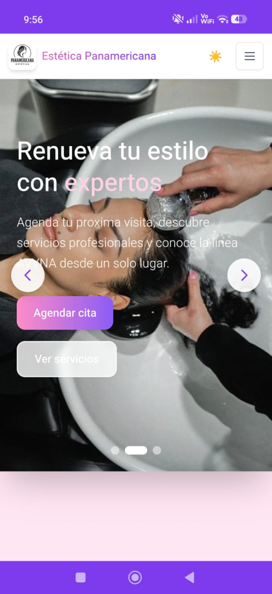
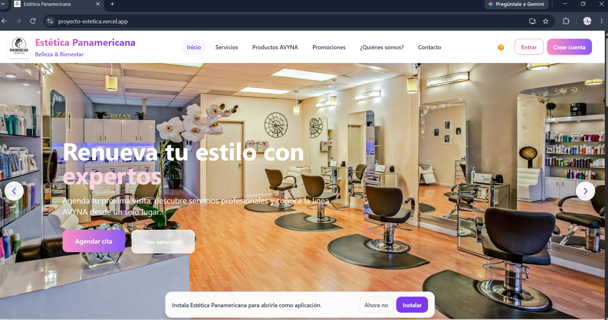
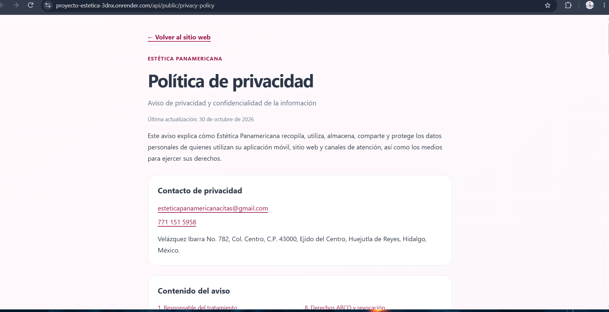
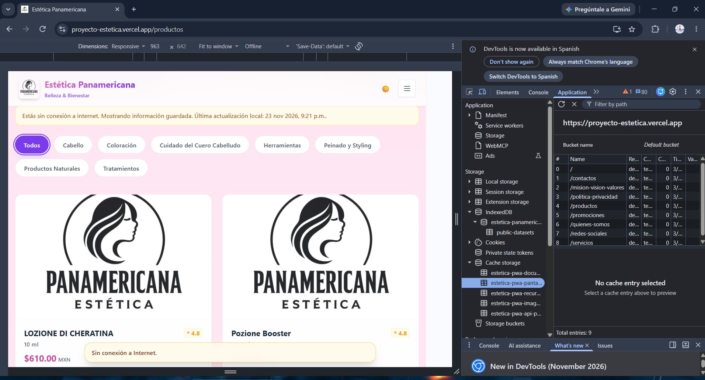
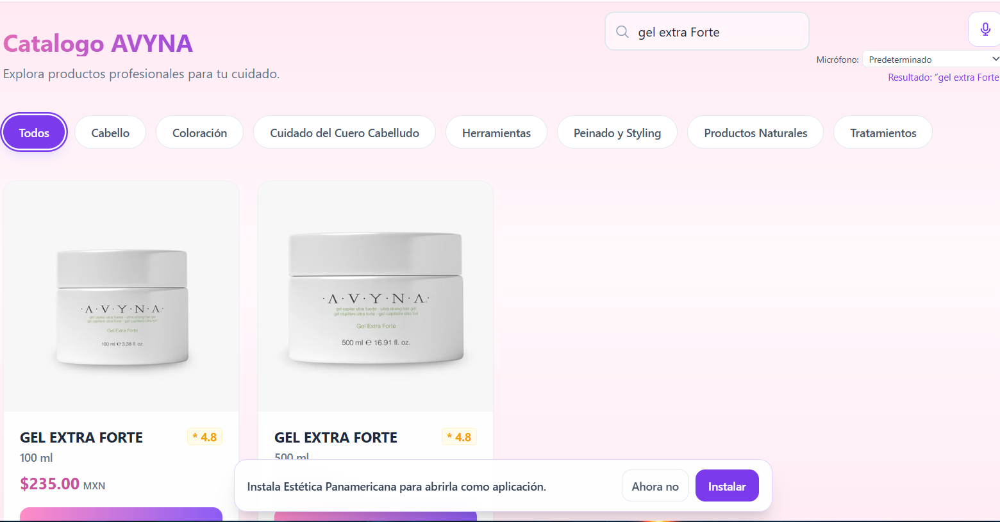

# Actividad 9-2: entrega de la PWA Estética Panamericana

**Materia:** Aplicaciones Web Progresivas  
**Caso de estudio:** sitio de Estética Panamericana  
**Entrega principal:** código fuente de la aplicación web progresiva en este repositorio

## Enlaces

- **Repositorio:** https://github.com/JoadanMatias10/Proyecto_Estetica
- **Aplicación publicada:** https://proyecto-estetica.vercel.app/
- **Vista HTML generada por el servidor:** https://proyecto-estetica-3dnx.onrender.com/api/public/privacy-policy
- **Manifiesto publicado:** https://proyecto-estetica.vercel.app/manifest.json
- **Service worker publicado:** https://proyecto-estetica.vercel.app/service-worker.js

## Caso de estudio

Estética Panamericana permite consultar productos, servicios, promociones e información del negocio. El frontend usa React; el servidor Express proporciona la API y algunas páginas HTML; MongoDB conserva los datos oficiales. La capa PWA agrega instalación, recursos públicos disponibles sin conexión, datos locales y avisos de estado. Las acciones privadas, como autenticación, citas y compras, requieren conexión.

## Correspondencia con los requisitos

| Requisito de la actividad | Implementación y ubicación en el repositorio | Alcance comprobable |
| --- | --- | --- |
| Pantallas **splash y home** | [Manifiesto](frootend/public/manifest.json), [rutas React](frootend/src/App.js) y [Home](frootend/src/Publico/Home.jsx) | La ruta `/` muestra home. En un Android compatible, el navegador puede generar el splash al abrir la PWA instalada a partir del manifiesto. No hay una pantalla Splash propia de React ni una captura directa de ese arranque. |
| Vistas del **cliente y del servidor** | [Entrada React](frootend/src/index.js), [rutas](frootend/src/App.js), [generador HTML](server/utils/privacyPolicy.js) y [ruta Express](server/routes/privacyPolicy.js) | Las vistas principales se construyen en el navegador. Express genera y entrega por separado la página HTML de política de privacidad; esto no significa que React se renderice en el servidor. |
| Datos **locales, remotos y offline** | [IndexedDB](frootend/src/utils/publicDataStore.js), [consulta de datos públicos](frootend/src/utils/publicCatalogApi.js), [API](frootend/src/api.js) y [service worker](frootend/public/service-worker.js) | IndexedDB conserva datos públicos saneados y Cache Storage guarda recursos y respuestas públicas. La API y MongoDB proporcionan los datos remotos. Solo las copias públicas ya disponibles pueden consultarse sin conexión. |
| **Notificaciones** | [Avisos PWA](frootend/src/components/pwa/PwaStatus.jsx) y [recordatorios de citas](server/utils/clientNotifications.js) | Hay avisos dentro de la interfaz y canales de recordatorio por correo, enlace de WhatsApp y registro interno. No se implementó Web Push ni una notificación del sistema con la aplicación cerrada. |
| **Elementos físicos del dispositivo** | [Búsqueda por voz](frootend/src/components/pwa/VoiceSearchButton.jsx), [catálogo](frootend/src/Publico/ProductosAvyna/Catalogo.jsx) y [ubicación en administración](frootend/src/Administrador/Empresa/InformacionEmpresa.jsx) | La búsqueda por voz solicita micrófono y la administración puede solicitar ubicación. Ambas funciones dependen de permisos, dispositivo y navegador compatibles. |

## Evidencia visual

Las siguientes imágenes proceden del reporte corregido de esta actividad. Su fecha y versión exactas no constan en las capturas.

**Figura A1. Home en dispositivo móvil.** Acredita la vista inicial en móvil; no muestra el splash.

**Figura A2. Home de la aplicación publicada.** Se observa la ruta principal y el aviso de instalación.

**Figura A3. Página HTML generada por Express.** Se observa la política de privacidad desde la URL del backend.

**Figura A4. Datos públicos sin conexión.** Se observan el catálogo, el aviso offline y los recursos de Cache Storage.

**Figura A5. Búsqueda en el catálogo y control de voz.** Se ven el filtro, los resultados y el botón de micrófono; la imagen por sí sola no verifica el permiso ni la captura física de voz.

## Pruebas y límites de la evidencia

En la revisión del **23 de noviembre de 2026**, la suite automatizada del frontend aprobó **9 de 9 suites y 30 de 30 pruebas** con `npm test -- --watchAll=false --runInBand` y `CI=true`. También respondieron el sitio publicado, el manifiesto, el service worker y la página HTML del backend. Estas comprobaciones acreditan disponibilidad y comportamiento automatizado, pero no sustituyen una prueba física de micrófono, geolocalización o splash en Android.

La Figura A4 muestra funcionamiento offline de contenido público. Las capturas A1, A2, A3 y A5 muestran las pantallas y controles indicados arriba. Quedan por documentar directamente el splash durante el arranque de la PWA instalada, la autorización y resultado del micrófono y el uso de la ubicación en un dispositivo real.

## Cómo revisar la entrega

1. Abrir el [sitio publicado](https://proyecto-estetica.vercel.app/) y comprobar la ruta `/`.
2. Abrir el [manifiesto](frootend/public/manifest.json) y el [service worker](frootend/public/service-worker.js) en este repositorio.
3. En Chrome DevTools, revisar **Application → Cache Storage** e **IndexedDB**; después activar **Network → Offline** y abrir una ruta pública visitada previamente.
4. Abrir la [política de privacidad del backend](https://proyecto-estetica-3dnx.onrender.com/api/public/privacy-policy) para ver la página HTML generada por Express.
5. Abrir `/productos` y localizar el botón de micrófono. La prueba de voz real requiere conceder permiso. La geolocalización se usa en `/admin/empresa` con una sesión de administrador.

Este archivo acompaña al código fuente ya presente en el repositorio y señala expresamente qué evidencia está completa y qué comprobación física sigue pendiente.
